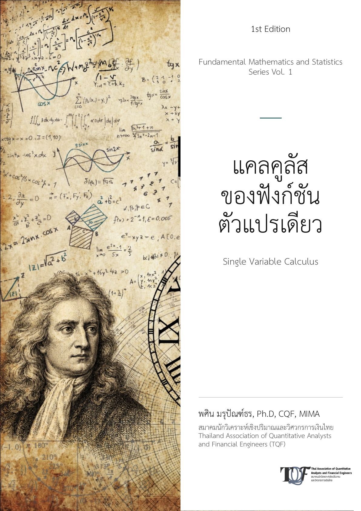

### แคลคูลัสของฟังก์ชันตัวแปรเดียว

<table>
  <tr>
    <td class="left-cell">
      
    </td>
    <td class="right-cell">
      

        <strong>แคลคูลัสของฟังก์ชันตัวแปรเดียว ฉบับพิมพ์ครั้งที่ 1</strong> เป็นเล่มที่ 1 ในชุดวิชาคณิตศาสตร์พื้นฐานและสถิติ เนื้อหาครอบคลุมลิมิตและความต่อเนื่อง การหาอนุพันธ์ การหาปริพันธ์ รูปแบบไม่กำหนด การประยุกต์อนุพันธ์ เทคนิคการหาปริพันธ์ และการประยุกต์ปริพันธ์ พร้อมการพิสูจน์อย่างละเอียดและภาพอธิบายเพื่อสนับสนุนการเรียนรู้อย่างเป็นระบบและการศึกษาด้วยตนเอง
      

      

        <a href="https://www.researchgate.net/profile/Pasin-Marupanthorn/publication/417125511_khaelkhulaskhxngfangkchantawpaerdeiyw/links/6ae34e060fef1c1d0a0c58aa/khaelkhulaskhxngfangkchantawpaerdeiyw.pdf?origin=profileOverview&amp;_tp=eyJjb250ZXh0Ijp7InBhZ2UiOiJwcm9maWxlIiwicHJldmlvdXNQYWdlIjoicHVibGljYXRpb24iLCJwb3NpdGlvbiI6InBhZ2VDb250ZW50Iiwic3ViUGFnZSI6Im92ZXJ2aWV3In19" class="button">อ่านหนังสือ</a>
      

    </td>
  </tr>
</table>

### แคลคูลัส II<table>
  <tr>
    <td class="left-cell">
      
    </td>
    <td class="right-cell">
      

        นี่คือคำอธิบายสั้น ๆ ของหนังสือ ซึ่งให้ภาพรวมของเนื้อหา เน้นคุณสมบัติสำคัญ และอธิบายกลุ่มผู้อ่านที่ตั้งใจจะได้อ่าน คำอธิบายควรกระชับแต่ให้ข้อมูลเพียงพอ เพื่อให้ผู้อ่านที่มีโอกาสได้อ่านเข้าใจชัดเจนว่าควรคาดหวังอะไรจากหนังสือเล่มนี้
      

    
upcoming

    </td>
  </tr>
</table>
